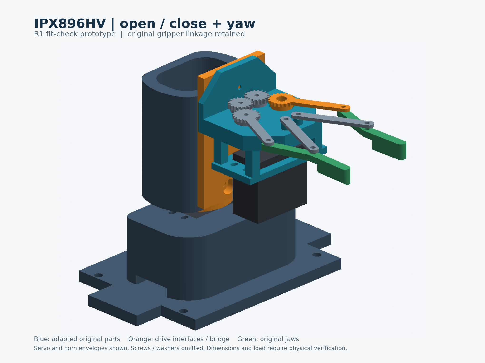

# MATE Workshop Gripper Design

R1 fit-check CAD for a two-degree-of-freedom mini-gripper: **open/close + left/right yaw**, provisionally using two GDW IPX896HV servos. The design adapts [vshreyas121-code/6-dof-robotic-arm](https://github.com/vshreyas121-code/6-dof-robotic-arm), retaining the original jaw, linkage, and gear tooth geometry wherever possible.

This is a prototype for printing and trial assembly. Servo mounting dimensions, metal horn compatibility, physical operation, and load capacity still require verification.

## Design files

- [Complete assembly STEP](output/IPX896HV_2DOF_assembly.step)
- [Printable parts](output/stl/) — 12 part types, 14 printed pieces; print `PRINT_2` files twice
- [Fit-check coupons](output/fit_checks/) — start with these STL files
- [Modified and new part STEP files](output/step/)
- [Traditional Chinese assembly instructions](README_繁體中文.md)
- [Assembly and trial-print guide (PDF)](output/裝配與試印指南.pdf)
- [Hardware bill of materials](BOM.csv)
- [Gear engagement review](output/preview/gear_review_R1.pdf)
- [Validation reports](output/validation/)



## R1 correction and remaining limitation

R1 raises the driving gear by 1.5 mm, increasing its axial tooth overlap with the adjacent idler from 0.5 mm to the full 2.0 mm driving-gear width. The jaws and spacer stack are aligned accordingly. Compared with R0, only M02 changes among the main printed parts; the F02 fit coupon is also updated.

The original tooth profiles remain in use. The nominal rigid gear-chain analysis estimates approximately **8.2–11.6 degrees of reversal free play** at the output gear over the assessed opening range. R1 corrects axial engagement but does not reduce this backlash. Trial assembly and practical bidirectional operation checks are required.

Recorded checks cover STEP re-import, closed and consistently oriented STL meshes, sampled solid interference, linkage closure, screw access, tooth overlap, and geometric gear-chain free play. These checks do not establish physical fit, load capacity, or continuous operation under load.

## Rebuild and inspect

Install Python dependencies from `requirements.txt`, then run:

```sh
python scripts/build.py
python scripts/check_and_render.py
python scripts/validate_motion.py
python scripts/verify_delivery.py
python scripts/verify_screw_access.py
python scripts/check_gears.py
```

The PDF and annotated gear-review scripts additionally use Noto Sans CJK fonts at the Linux paths documented in the Chinese instructions. Generated `work/` files, local logs, and Python caches are excluded from version control.

`parameters.json` records nominal dimensions and unverified inputs. `source_manifest.json` pins the upstream source to commit `258d1893ba1b8b49e87baa79da462680fd53681b`. `DELIVERY_SHA256SUMS.txt` records the original R1 delivery contents; this repository README and Git configuration files are additional publication files.

## License and attribution

MIT. See [LICENSE](LICENSE), [NOTICE.txt](NOTICE.txt), and the retained [upstream license](upstream/LICENSE).
