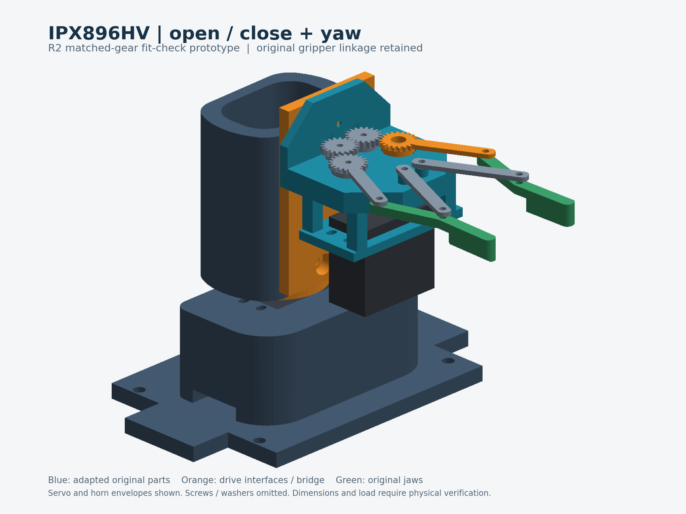

# MATE Workshop Gripper Design

[繁體中文首頁](../README.md) · [Model and print inventory](../output/README.md) · [Documentation index](README.md)

R2 fit-check CAD for a two-degree-of-freedom mini-gripper: **open/close + left/right yaw**, provisionally using two GDW IPX896HV servos. The design adapts [vshreyas121-code/6-dof-robotic-arm](https://github.com/vshreyas121-code/6-dof-robotic-arm), retaining the original jaws, linkage interfaces, gear hubs, and base layout while replacing the working gear teeth with matched involute profiles.

This is a prototype for printing and trial assembly. Servo mounting dimensions, metal horn compatibility, physical operation, and load capacity still require verification.

## Design files

- [Complete assembly STEP](../output/IPX896HV_2DOF_assembly.step)
- [Printable parts](../output/stl/) — 12 part types, 14 printed pieces; print `PRINT_2` files twice
- [Fit-check coupons](../output/fit_checks/) — servo/horn checks plus a four-gear trial plate and three clearance options
- [Modified and new part STEP files](../output/step/)
- [Traditional Chinese assembly instructions](assembly.md)
- [Assembly and trial-print guide (PDF)](../output/裝配與試印指南.pdf)
- [Hardware bill of materials](../BOM.csv)
- [Gear engagement review](../output/preview/gear_review_R2.pdf)
- [Validation reports](../output/validation/)



## R2 gear improvement

The four working gear rims now use module 0.75, a 20-degree pressure angle, and the original 20/19/19/20 tooth counts. Each idler pivot moves approximately 0.257 mm to give matching center distances. R1's full 2.0 mm axial tooth engagement is retained, as are the hubs, mounting interfaces, link lengths, jaws, and base parts.

The exported CAD profiles give approximately **2.75 degrees of output reversal free play** over the assessed 0–36-degree input range, compared with R1's approximately 8.2–11.6 degrees. This meets the provisional CAD target of at most 3 degrees. It excludes printing error, bearing clearance, elastic deflection, friction, and servo backlash; physical performance remains unverified.

Upgrading from R1 replaces **four part types, five printed pieces**: M01, M02, M05 (replacing U05), and M06 ×2 (replacing U04 ×2). Use the R2 palm and gears together. The main assembly still contains 14 printed pieces. The remaining part geometry is retained and checked against the R1 baseline.

Print F05 and two each of the B12 20T/19T trial gears first. B08, B12, and B16 denote nominal per-mesh tangential backlash of 0.08, 0.12, and 0.16 mm. The main parts use B12. A different choice requires regenerating and validating the main gears; B16 can exceed the current 3-degree CAD target.

Recorded checks cover 20 STEP re-imports, 23 closed and consistently oriented STL meshes, 145 nominal gear-profile positions, 20 gripper linkage poses at the opening/closing tooth-contact limits, nominal opening and yaw samples, linkage closure, screw access, and preservation of existing interfaces. These checks do not establish physical fit, load capacity, or continuous operation under load.

## Rebuild and inspect

Install Python dependencies from the root `requirements.txt`, then run these commands from the repository root:

```sh
python scripts/build.py
python scripts/check_and_render.py
python scripts/check_gears.py
python scripts/validate_motion.py
python scripts/verify_delivery.py
python scripts/verify_screw_access.py
python scripts/verify_revision.py
python scripts/plot_gear_review.py
python scripts/make_guide.py
python scripts/package_delivery.py
```

The PDF and annotated gear-review scripts additionally use Noto Sans CJK fonts at the Linux paths documented in the [build guide](build.md). Packaging writes the ZIP and standalone delivery files to `dist/`; use `python scripts/package_delivery.py --output-dir /tmp/gripper-delivery` to choose another directory. Generated `dist/` and `work/` files, local logs, and Python caches are excluded from version control.

`parameters.json` records nominal dimensions and unverified inputs. `source_manifest.json` pins the upstream source to commit `258d1893ba1b8b49e87baa79da462680fd53681b`. `reference/` retains the R1 comparison data. `DELIVERY_SHA256SUMS.txt` records the R2 packaged source and deliverables; Git metadata is excluded.

## License and attribution

MIT. See [LICENSE](../LICENSE), [NOTICE.txt](../NOTICE.txt), and the retained [upstream license](../upstream/LICENSE). Version history is in [CHANGELOG.md](../CHANGELOG.md).
